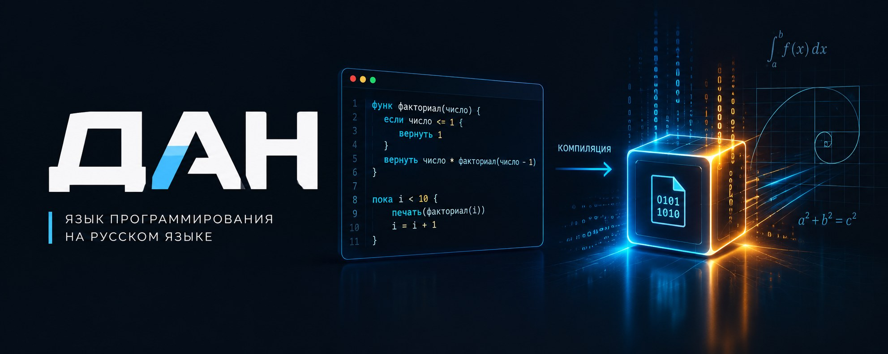

# Дан



**Дан - это язык программирования, на котором программы пишутся по-русски.** Вместо английских слов `if`, `while`, `function` в нём используются привычные `если`, `пока`, `функ`. Готовую программу Дан превращает в обычный файл `.exe`, который запускается двойным щелчком, как любая другая программа.

Текущая версия - 1.4. Программы, написанные для версии 1.0 и новее, будут работать и во всех следующих версиях Дана.

## Главное о языке

- **Понятно.** Код читается на родном языке, а сообщения об ошибках написаны по-русски и подсказывают, как их исправить.
- **Быстро.** Программа собирается в машинный код и не требует ничего устанавливать у того, кто её запускает.
- **Надёжно.** Дан находит многие ошибки ещё до запуска программы.
- **Универсально.** На Дане можно писать программы любого назначения: с окнами, документами Word, Excel и PDF, почтой, базой данных. Они работают в Windows, Linux, macOS и в браузере.

## Установка в Windows

Откройте страницу последнего выпуска: https://github.com/alexandervdanchenko-ai/dan/releases/latest, скачайте файл `dan-...-setup.exe` и запустите его. Права администратора не нужны, Python и компилятор C ставить не нужно: всё необходимое уже внутри.

После установки в меню «Пуск» появится папка «Дан»: в ней редактор, учебник «Дан с нуля», справочник и командная строка. Примеры программ лежат в папке «Документы\Дан\примеры». Программу `.dan` можно запустить двойным щелчком или командой в любом окне командной строки:

```
dan запустить программа.dan
dan собрать программа.dan
```

Вторая команда создаёт обычный файл `.exe`, который можно передать другим людям. Упражнения с автоматической проверкой: `dan задачи` и `dan задача 1`.

Новую версию ставит команда `dan обновить`. Официально Дан распространяется только через страницу выпусков.

Для разработки самого Дана (с исходным кодом и тестами) подходит сценарий `установить_windows.ps1`: он ставит Python, компилятор C и Git и загружает проект.

Подробное описание языка - в файлах `справочник.md` и `spec.md`, примеры программ - в папке `примеры`. Языковой модели, которая пишет на Дане, достаточно дать файл `llms-full.txt`. Как устроен сам Дан и как участвовать в его разработке - в файле `УЧАСТИЕ.md`.

## Лицензия

Дан распространяется бесплатно по лицензии MIT (файл `LICENSE`). Программы, написанные на Дане, принадлежат их авторам. Части библиотеки выполнения (папка `sreda`), которые Дан включает в собранную программу, можно распространять в её составе без уведомления об авторском праве и без текста лицензии.

Additional permission: portions of the runtime library (the `sreda` directory) that the Dan compiler includes in a program it builds may be distributed as part of that program without the above copyright notice and permission notice.
